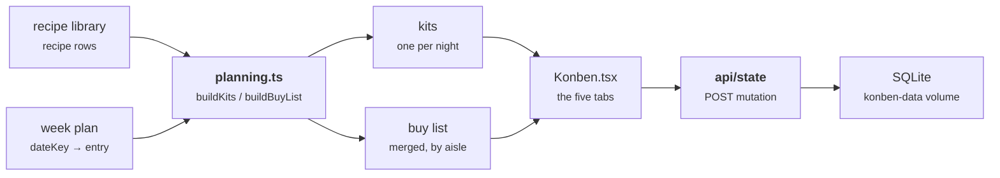

# Konben field guide

*How the app is put together.*

Self-hosted meal kits, no subscription. A week board, a bagged kit per cooking night, a merged shopping list, and macros a plate — for a household that plans dinner once and shops for it once.

| | |
| --- | --- |
| **Stack** | Next.js 16 · React 19 · SQLite (Drizzle) |
| **Runs** | docker compose · localhost:3000 |
| **Auth** | none — trusted network only |

**On this page:** [The one rule](#premise) · [Running it](#running-it) · [A tour of the app](#a-tour-of-the-app) · [Adding recipes](#adding-recipes) · [How it fits together](#how-it-fits-together) · [Data model](#data-model) · [Configuration](#configuration) · [Developing](#developing)

## Premise

### A meal-kit service, minus the subscription

Konben gives a household the part of a subscription meal-kit box worth having — a bagged, portioned kit for each cooking night and a shopping list that's already done the merging — built from recipes you actually own, run on hardware you actually own, with no box arriving and no plan to cancel.

> [!TIP]
> **The trick that makes it affordable**
>
> A recipe that reheats well can be cooked in a double batch: set a dinner to **cook for two nights**, and the night after it is claimed as leftovers automatically — no recipe assigned, nothing added twice to the shopping list, one kit sized for both nights instead of two. It's the one mechanic that lets a home kitchen match a subscription kit's portioning without paying its markup.

## Running it

The whole app is one container. State lives in SQLite on the `konben-data` volume, so it survives rebuilds and follows the household between devices on the same network.

```sh
# from the project root
docker compose up --build
# → http://localhost:3000
```

There is no login: anyone who can reach the port can see and edit the plan. That's the intended trade for a household app on a trusted network — LAN, Tailscale, VPN. Don't expose the port to the internet. Writes must be sent as `application/json` (anything else gets a 415), so a web page open on the same network can't post changes with a plain form.

## A tour of the app

Five tabs, each reading off the same week: `Week`, `Kits`, `Buy list`, `Recipes`, `Macros`.

- **Week board** — seven nights, a recipe assigned or empty. Assigning a recipe defaults its servings and sets `cookFor: 1`; ticking "cook for two" claims the following night as leftovers and pulls it out of the board.
- **Kits** — one card per cooking night, portioned to however many nights it covers. Each kit splits its ingredients into what goes in the bag (`contents`) and what's assumed already in the cupboard (`cupboard`), and can be marked packed.
- **Buy list** — every kit's ingredients merged into one list, grouped by aisle, quantities summed where the same item shows up in more than one recipe. Items merge on name and unit, ignoring case and singular/plural ("Lemon" and "Lemons" are one line); a different unit or a synonym ("Cilantro", "Coriander") stays a separate line. Ticking an item off is a per-item write, not a whole-list refresh, and ticks belong to their week.
- **Recipes** — the library: the thirteen recipes the app starts with, plus anything added by hand or through Claude Code. Each recipe carries minutes, servings, macros, a reheat rating, ingredients, and steps, in the meal-box card format (subtitle, prep time, equipment, titled steps, callouts), whether it came from the Add a recipe form or from Claude Code.
- **Macros** — a chart of the week against household goals (kcal, protein, carbs, fat — editable), with leftovers nights correctly attributed to the recipe that's actually being eaten.

**Reheat quality** is the rating that governs whether a recipe is a sane candidate for the double-cook rule:

- 🟢 **great** — barely changes reheated
- 🟡 **ok** — fine with a fix (loosen a sauce, add a splash of stock)
- 🔴 **poor** — cook it fresh each time; not a leftovers candidate

**Ingredients** sort into six aisles, and any item marked a staple is assumed already in the cupboard — kept out of the kit bag, and hidden on the buy list behind a "Show cupboard staples" toggle. When dinners share an item, it only counts as a staple if every one of them marks it so; one recipe that needs it bought puts it back on the list:

`Produce` · `Protein` · `Dairy` · `Bakery` · `Pantry` · `Frozen` · **staple → cupboard**

## Adding recipes

Write the recipe as JSON in the card format (`RecipeSchema` in `src/lib/schema.ts` defines it; `REQUIREMENTS.md` has the content standards) and post it to the running app:

```sh
node scripts/add-recipe.mjs recipe.json
node scripts/add-recipe.mjs recipes.json --url http://<your-host>:3000
```

The recipe shows up under **Recipes** on the next refresh — no rebuild needed. If a field is wrong, the script prints exactly which one, because the same `RecipeSchema` that validates the Add-a-recipe form in the UI validates this. You can also add one by hand, in the app, under Recipes → Add a recipe.

Every recipe lives in the database, on the volume, including the thirteen the app starts with, so editing any of them needs no rebuild. Deleting a recipe removes it for good.

## How it fits together

One rule set, applied everywhere. `lib/planning.ts` turns a plan into kits and a buy list; every edit to the week goes through the same reducers, whether it comes from a click in the UI or a script.



A click in the UI calls a reducer in `planning.ts` → posts just the changed rows to `/api/state` → applied in one SQLite transaction, so two devices editing different nights never clobber each other.

| Module | Role |
| --- | --- |
| `lib/planning.ts` | The rules: kits, the buy list, and every plan edit — assign, clearDay, setServings, setCookFor, clearWeek, randomizeWeek. |
| `hooks/useKitchenState.ts` | Client state and the writes it sends; optimistic local update, then a row-scoped POST. |
| `app/api/state/route.ts` | Reads the whole kitchen on GET; applies one validated mutation per POST, inside a transaction. |
| `lib/schema.ts` | What a valid recipe is — a Zod schema enforced at the API boundary, shared by the UI form and add-recipe.mjs. |
| `scripts/add-recipe.mjs` | Posts a recipe (or an array of them) into a running instance from the command line. |
| `scripts/plan-week.mjs` | Lists, picks and writes a week of dinners from the command line — 2 plates a night unless told otherwise, same as the app. |

## Data model

Five tables, each about as small as the thing it's tracking. A plan entry is identified by its date; a mutation is one of eight operations, validated and applied as a single transaction so a cascade — like deleting a recipe out from under a planned night — never half-applies.

| Table | Key | Holds |
| --- | --- | --- |
| `plan_entries` | `date_key` | Which recipe, how many servings, cook for 1 or 2 nights — one row per planned night. |
| `custom_recipes` | `id` | Every recipe, built-in or added by hand or via `add-recipe.mjs`, stored as a JSON document. |
| `settings` | `id = 1` | The single row holding the household's macro targets. |
| `checks` | `key` | Ticked shopping items and packed kits, told apart by `kind`. |
| `pantry_items` | `key` | What's on hand in the kitchen: a name and an optional use-by. |

**Mutations**, all POSTed to `/api/state`:

| op | Effect |
| --- | --- |
| `plan.write` | Upserts the given date → entry rows, deletes the given date keys — never a whole-week rewrite. Refused if an entry names a recipe that doesn't exist. |
| `goals.write` | Replaces the macro targets. |
| `checks.write` | Adds/removes ticked or packed rows. |
| `checks.clear` | Clears one kind of check (ticked or packed) for the given `days` — the week on screen — or for every week if no days are given. |
| `recipe.add` | Upserts a custom recipe, validated against `RecipeSchema`. |
| `recipe.delete` | Deletes a recipe and clears any night still pointing at it. |
| `pantry.add` | Adds or updates an on-hand item, keyed by its plain name, with an optional use-by. |
| `pantry.remove` | Removes on-hand items by key. |

## Configuration

| Variable | Default | |
| --- | --- | --- |
| `DATABASE_PATH` | `./konben.db` | Set to `/data/konben.db` in the container. |
| `TZ` | system | Set it to the household's zone — the week runs on local time. |
| `KONBEN_URL` | `http://localhost:3000` | Where `add-recipe.mjs` and `plan-week.mjs` post to, when not overridden with `--url`. Set it to `http://<your-host>:3000` when the app runs on another machine. |

## Developing

```sh
npm install
npm run dev          # http://localhost:3000, database at ./konben.db
npm test             # planning rules and the /api/state route
npm run typecheck
npm run lint         # eslint, next's core-web-vitals + typescript rules
```

`npm run db:generate` writes a new migration to `drizzle/` after a schema change; migrations apply automatically at boot.
